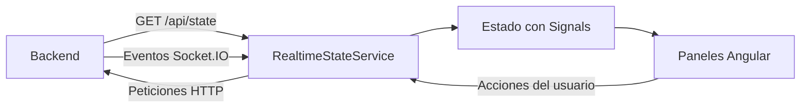

# Elite Companion · Frontend

Dashboard web para seguir una partida de **Elite Dangerous**, un simulador espacial, desde el navegador. Reúne el estado de la nave, la ubicación, las rutas, las misiones y la colonización en una misma interfaz con actualizaciones en tiempo real.

Este repositorio contiene la aplicación **Angular**. Los datos y las integraciones externas proceden del [backend de Elite Companion](https://github.com/troto742/ed_companion_back), desarrollado con Node.js, Express y Socket.IO.

## Qué puedes hacer

- Consultar la nave, combustible, carga y ubicación del comandante.
- Importar rutas CSV o Excel y seguir su progreso.
- Generar rutas con Spansh, incluida la planificación a partir de una configuración de nave.
- Guardar rutas en el navegador para recuperarlas después.
- Consultar misiones activas e historial y seguir el progreso y los materiales de colonización.
- Buscar mercancías y consultar recomendaciones comerciales.
- Acceder mediante una API key y visualizar el estado asociado a ella.
- Ver el estado de conexión y los errores de comunicación con el backend.

Para mostrar datos de una partida real, un cliente de telemetría debe enviarlos al backend. También puedes probar la interfaz con un evento simulado, sin abrir el juego.

## Tecnologías y decisiones técnicas

| Tecnología | Uso en el proyecto |
| --- | --- |
| Angular 20 + TypeScript | Aplicación con componentes standalone y contratos tipados. |
| Angular Signals | Estado reactivo del snapshot, conexión y errores. |
| HttpClient + RxJS | Consulta inicial y operaciones HTTP. |
| Socket.IO Client | Recepción de cambios en tiempo real. |
| CSS | Presentación y estilos de los paneles. |
| localStorage | API key, configuración y rutas guardadas en el navegador. |
| Docker + Nginx + Jenkins | Compilación, servicio de archivos estáticos y despliegue. |

La integración HTTP y Socket.IO se centraliza en `RealtimeStateService`. Los paneles reciben el estado para representarlo, mientras el servicio mantiene la conexión y los datos compartidos. Esto proporciona un punto común para gestionar la comunicación con el backend.

## Cómo funciona



Al introducir una API key válida, la aplicación carga el estado inicial y se conecta a Socket.IO con esa misma clave. Los eventos `StateUpdated`, `MissionUpdated` y `ColonizationUpdated` mantienen los datos de la interfaz actualizados sin recargar la página.

## Arranque local

Necesitas **Node.js 22.12 o superior dentro de la rama 22**, npm 10 o superior y el backend en ejecución. Ejecuta los comandos desde la raíz de este repositorio, la carpeta `frontend` si usas el workspace completo.

1. Arranca el backend siguiendo su README. Para una demostración, utiliza `API_KEY=dev-api-key`, `DATABASE_URL=` y `CORS_ORIGIN=http://localhost:4201`.
2. Instala las dependencias y arranca Angular:

   ```bash
   npm ci
   npm start
   ```

3. Abre esta dirección:

   ```text
   http://localhost:4201/?backendUrl=http://localhost:3000
   ```

4. Introduce `dev-api-key` en el formulario de acceso, o la clave que hayas configurado en el backend.

El puerto de desarrollo es **4201**. `backendUrl` se guarda en el navegador; si no hay una URL configurada, la aplicación utiliza su propio origen. En desarrollo conviene indicar el backend explícitamente porque Angular y la API usan puertos distintos.

La API key se introduce en el formulario y se guarda en `localStorage`; el código actual no la lee del parámetro `?apiKey=`.

## Prueba rápida sin el juego

Con ambos proyectos arrancados y la sesión abierta con `dev-api-key`, ejecuta este comando desde otra terminal con Node.js 22. Funciona en Bash y PowerShell:

```bash
node -e "fetch('http://localhost:3000/api/ingest/status', { method: 'POST', headers: { 'Content-Type': 'application/json', 'x-api-key': 'dev-api-key' }, body: JSON.stringify({ timestamp: new Date().toISOString(), starSystem: 'Sol', fuel: { main: 24 }, cargo: 8 }) }).then(async r => console.log(r.status, await r.json()))"
```

El backend debe responder con HTTP `202` y `accepted: true`. La interfaz mostrará `Sol` como sistema y actualizará los datos de combustible y carga sin recargar la página. Los paneles de misiones y colonización necesitan sus correspondientes eventos; esta prueba solo envía un estado básico.

## Organización del código

```text
src/
├── main.ts                         # Arranque de Angular
├── styles.css                      # Estilos globales
└── app/
    ├── app.ts                      # Layout, acceso y navegación entre secciones
    ├── app.config.ts               # Proveedores de la aplicación
    ├── app.routes.ts               # Configuración del router
    ├── realtime-state.service.ts   # HTTP, Socket.IO y estado reactivo
    ├── state.types.ts              # Contratos del estado recibido
    └── components/
        ├── app-header.component.ts
        ├── ship-status-panel.component.ts
        ├── location-panel.component.ts
        ├── galaxy-route-panel.component.ts
        ├── mission-board-panel.component.ts
        ├── colonization-panel.component.ts
        └── trade-recommendations-panel.component.ts
```

Los componentes utilizan templates y estilos inline. Para entender el flujo, empieza por [app.ts](src/app/app.ts), continúa con [RealtimeStateService](src/app/realtime-state.service.ts) y después revisa el panel que te interese.

## Configuración en el navegador

| Dato | Cómo se configura | Almacenamiento |
| --- | --- | --- |
| URL del backend | Parámetro `backendUrl` en la URL. | `elite-backend-url` |
| API key | Formulario de acceso. | `elite-api-key` |
| Clave administrativa | Flujo de creación de claves o parámetro `adminKey`. | `elite-admin-key` |
| Rutas guardadas | Acciones del panel de rutas. | `elite-companion-saved-routes` |

La creación de API keys requiere que el backend tenga PostgreSQL y una clave administrativa configurados. No es necesaria para probar el dashboard con una clave existente.

Los datos de `localStorage` pertenecen al navegador y al origen utilizado; las rutas guardadas localmente no se sincronizan entre dispositivos. Las claves también quedan accesibles al JavaScript de ese origen. Evita compartir URLs que contengan claves administrativas y utiliza únicamente claves de demostración en capturas públicas.

## Comandos disponibles

| Comando | Resultado |
| --- | --- |
| `npm start` | Servidor de desarrollo en `http://localhost:4201`. |
| `npm run build` | Compilación de producción en `dist/elite-client/`. |
| `npm run watch` | Compilación continua con configuración de desarrollo. |
| `npm run ng -- <comando>` | Acceso al CLI local de Angular. |

Actualmente no hay scripts `npm test` ni pruebas end-to-end configurados. La compilación valida la aplicación, pero no sustituye las pruebas de comportamiento.

## Docker y despliegue

```bash
docker build -t elite-companion-frontend .
docker run --rm -p 4201:80 elite-companion-frontend
```

El Dockerfile compila Angular y sirve `dist/elite-client/browser` con Nginx. Abre la aplicación con un `backendUrl` accesible **desde el navegador** y permite ese origen en el CORS del backend.

El [nginx.conf](nginx.conf) incluido sirve la aplicación y resuelve las rutas al `index.html`; no configura un proxy para `/api` ni Socket.IO. Para usar frontend y backend bajo un mismo dominio, el despliegue debe añadir ese proxy. Si el frontend se publica con HTTPS, el backend también debe ser accesible de forma segura.

El [Jenkinsfile](Jenkinsfile) incluye build de imagen, publicación en Docker Hub y despliegue por SSH. Sus credenciales y destino deben adaptarse al entorno donde se reutilice.

## Problemas habituales

| Síntoma | Qué revisar |
| --- | --- |
| Acceso rechazado o error 401 | La clave debe existir y coincidir con la configuración del backend. |
| Peticiones dirigidas al frontend | Indica `backendUrl=http://localhost:3000` al abrir la aplicación local. |
| Errores de CORS o de Socket.IO | Revisa la URL del backend, `CORS_ORIGIN` y el proxy del despliegue. |
| Paneles vacíos tras acceder | El backend necesita recibir eventos; ejecuta la prueba rápida. |
| Sigue conectando a un backend antiguo | Abre con el nuevo `backendUrl` para actualizar el valor guardado. |
| No se pueden crear claves | Comprueba PostgreSQL y la clave administrativa del backend. |

## Qué muestra este proyecto y cómo puede evolucionar

El código reúne integración REST y Socket.IO, manejo de estado con Signals, formularios, componentes standalone y empaquetado para despliegue. Permite seguir un flujo completo desde un evento de telemetría hasta su representación en pantalla.

Los siguientes pasos serían añadir pruebas del servicio y del flujo de acceso, extraer responsabilidades de los paneles más grandes y ofrecer un modo de demostración con datos precargados. Para presentar el proyecto en un portfolio, una captura del dashboard y una demo con datos ficticios facilitarían entender su resultado visual.
